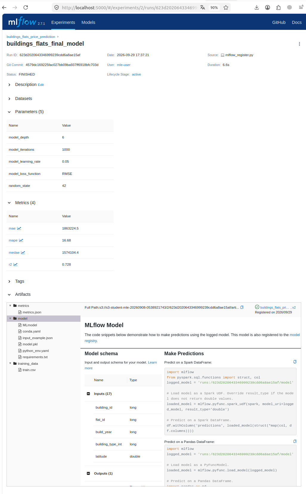
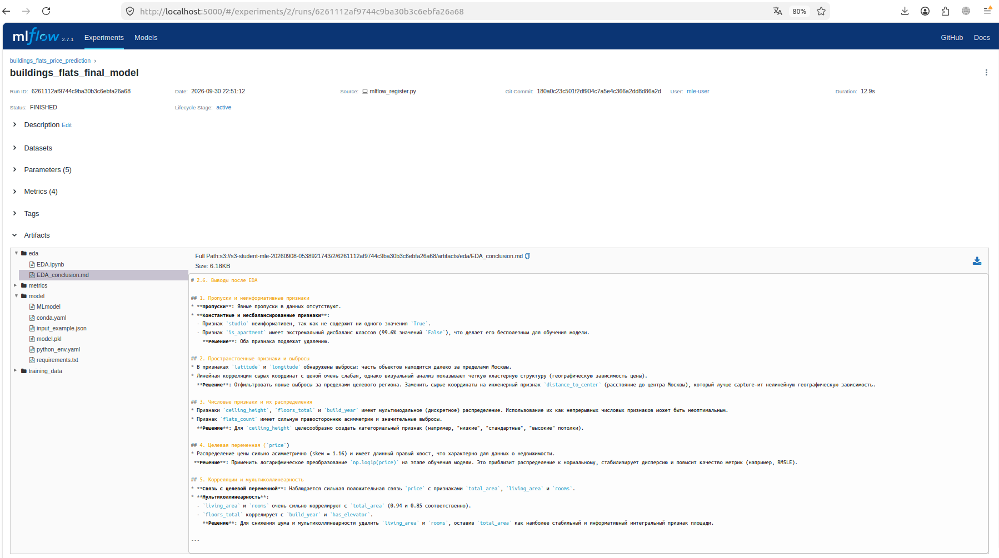
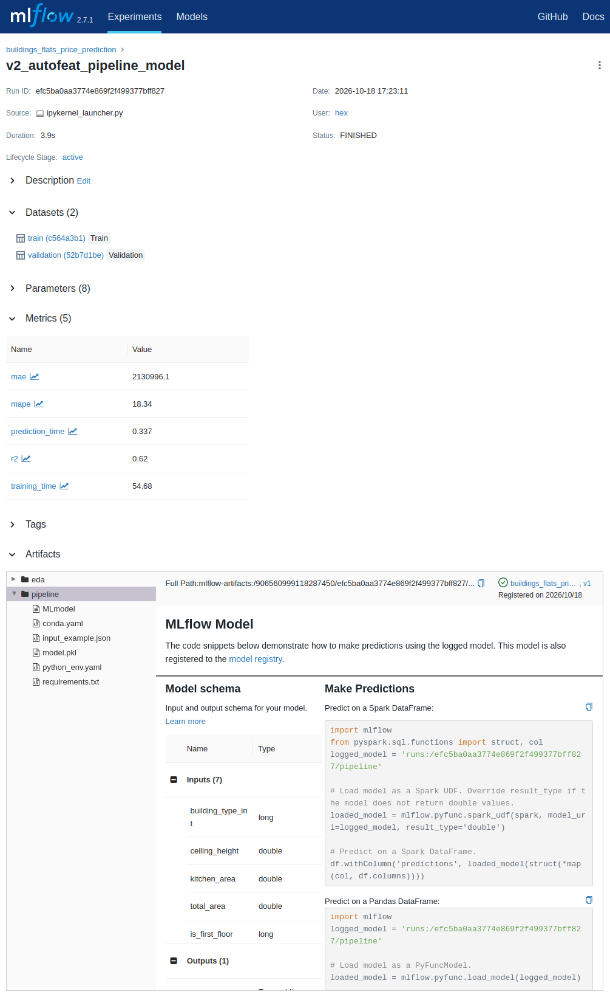
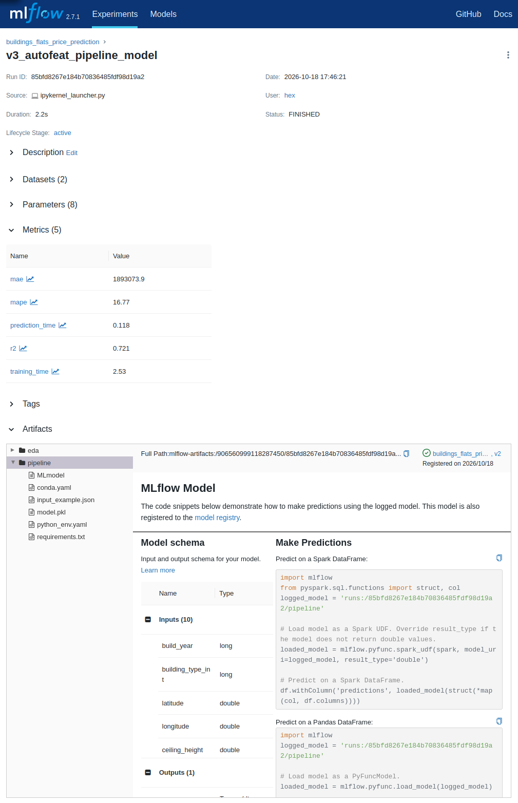
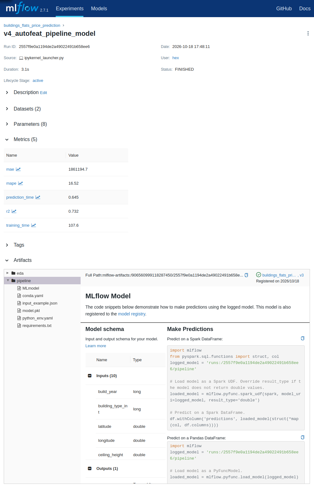

# Проект "Улучшение baseline-модели"

## О проекте

Репозиторий содержит решение проекта 2 спринта: улучшение baseline модели для прогнозирования стоимости квартир Яндекс Недвижимости.

## Хранилище артефактов

**Имя бакета:** `s3-student-mle-20260908-0538921743`

Endpoint: `https://storage.yandexcloud.net`

Чтобы проверить артефакты, выполните `dvc pull` в директории `part2_dvc/` —
будут скачаны датасеты (`data/*.csv`) и обученная модель
(`models/fitted_model.pkl`).

---

## Этап 1. Разворачивание MLflow Tracking Server и MLflow Model Registry. Регистрация существующей модели.

### 1.1. Настройка окружения

Для работы используются два независимых `.env`-файла:

1. **`.env` для MLflow-сервера** — инфраструктурные параметры (БД, S3).
2. **`.env` для регистрации модели** — параметры подключения к MLflow и имена сущностей.

#### `.env` для MLflow-сервера

Скопируйте шаблон переменных окружения и заполните его своими значениями:

```bash
cp mlflow_server/mlflow_env_template mlflow_server/.env
```

В `.env` должны быть заданы следующие переменные:

| Переменная | Назначение |
|---|---|
| `MLFLOW_S3_ENDPOINT_URL` | Адрес S3-совместимого хранилища для артефактов |
| `AWS_ACCESS_KEY_ID` | Ключ доступа к S3 |
| `AWS_SECRET_ACCESS_KEY` | Секретный ключ S3 |
| `S3_BUCKET_NAME` | Имя бакета для артефактов |
| `DB_DESTINATION_USER` | Пользователь БД (backend store) |
| `DB_DESTINATION_PASSWORD` | Пароль БД |
| `DB_DESTINATION_HOST` | Хост БД |
| `DB_DESTINATION_PORT` | Порт БД |
| `DB_DESTINATION_NAME` | Имя базы данных |
| `EXPERIMENT_NAME` | Имя эксперимента в MLflow |
| `MODEL_NAME` | Имя регистрируемой модели |
| `MLFLOW_URI` | URI MLflow-сервера (по умолчанию `http://localhost:5000`) |

#### `.env` для регистрации модели

```bash
cp mlflow_server/registrate_env_template .env
```

В этом `.env` указываются только параметры, необходимые скрипту `mlflow_register.py`:

| Переменная | Обязательность | Значение по умолчанию | Назначение |
|---|---|---|---|
| `EXPERIMENT_NAME` | опционально | `buildings_flats_price_prediction` | Имя эксперимента в MLflow, в который логируется run |
| `MODEL_NAME` | опционально | `buildings_flats_price_model` | Имя регистрируемой модели в MLflow Model Registry |
| `MLFLOW_URI` | опционально | `http://localhost:5000` | URI MLflow-сервера (tracking URI) |

> Переменные `EXPERIMENT_NAME`, `MODEL_NAME` и `MLFLOW_URI` имеют значения по умолчанию в коде, поэтому `.env` для регистрации модели можно не создавать, если используются дефолтные значения. Однако при работе с удалённым MLflow или другим именем эксперимента/модели — файл обязателен.

#### Зависимости

Установите зависимости:

```bash
pip install -r requirements.txt
```

### 1.2. Запуск MLflow-сервера

Скрипт для поднятия MLflow-сервисов: [`mlflow_server/run_mlflow_server.sh`](mlflow_server/run_mlflow_server.sh)

Скрипт выполняет:
- загрузку переменных из `.env`;
- экспорт переменных для доступа к S3;
- запуск `mlflow server` с backend-store в PostgreSQL и artifact-root в S3.

Запуск:

```bash
cd mlflow_server
./run_mlflow_server.sh
```

После запуска MLflow UI доступен по адресу `http://localhost:5000`.

### 1.3. Регистрация модели:

Скрипт регистрации модели: [`mlflow_server/scripts/mlflow_register.py`](mlflow_server/scripts/mlflow_register.py)

Скрипт выполняет:
- загрузку `.env` (параметры подключения к MLflow);
- подключение к MLflow и установку эксперимента;
- загрузку параметров из `params.yaml`;
- загрузку обученной модели из `models/fitted_model.pkl`;
- загрузку обучающих данных и метрик валидации;
- логирование параметров, метрик и артефактов;
- регистрацию модели под именем `MODEL_NAME`.

Запуск:

```bash
python mlflow_server/scripts/mlflow_register.py
```

После успешного выполнения в консоль выводятся `Run ID` и имя зарегистрированной модели.

### 1.4. Эксперимент в MLflow

- **ID эксперимента:** `623d2020643346999239cdd6a8ae15af`
- **Название эксперимента:** `buildings_flats_price_prediction`

Ссылка на эксперимент в MLflow UI:

```
http://localhost:5000/#/experiments/2/runs/623d2020643346999239cdd6a8ae15af
```



## Этап 2. Проведение исследовательского анализа данных и логирование Jupyter Notebook с EDA в MLflow.

### 2.1. Ключевые шаги и выводы EDA

**Проведенный анализ:**
* Проверка пропусков и распределений признаков
* Анализ выбросов и мультиколлинеарности
* Исследование целевой переменной

**Ключевые выводы:**

1. **Неинформативные признаки**: Выявлены признаки `studio` (константный) и `is_apartment` (99.6% дисбаланс), которые не несут полезной информации для модели.

2. **Географические выбросы**: Обнаружены объекты за пределами Москвы по координатам. Сырые координаты имеют слабую линейную связь с ценой, но четкую кластерную структуру.

3. **Распределения признаков**: Признаки `ceiling_height`, `floors_total`, `build_year` имеют мультимодальное распределение. `flats_count` демонстрирует сильную асимметрию.

4. **Целевая переменная**: `price` имеет асимметричное распределение (skew=1.16) с длинным правым хвостом, что требует логарифмического преобразования.

5. **Мультиколлинеарность**: Высокая корреляция между `total_area`, `living_area` и `rooms` (0.85-0.94).

**Принятые решения по предобработке:**
- Удаление неинформативных признаков (`studio`, `is_apartment`)
- Фильтрация географических выбросов
- Создание инженерных признаков: `distance_to_center`, `is_first_floor`, `is_last_floor`
- Категоризация `ceiling_height`
- Удаление коррелирующих признаков (`living_area`, `rooms`)
- Логарифмическое преобразование целевой переменной

### 2.2. Логирование артефактов в MLFlow

Артефакты: 
* [`model_improvement/notebook.ipynb`](model_improvement/notebook.ipynb) - Jupyter Notebook с проведенным EDA;
* [`model_improvement/EDA_conclusion.md`](model_improvement/EDA_conclusion.md) - Markdown-файл с выводами по проведенному EDA.

Для логирования артефактов был доработан скрипт регистрации модели: [`mlflow_server/scripts/mlflow_register.py`](mlflow_server/scripts/mlflow_register.py).

**Результат**:



## Этап 3. Генерация признаков и обучение модели

### 3.1. Выполненные шаги

**Предобработка и генерация признаков:**

Ручная генерация. На основе EDA были созданы новые признаки:

* `is_first_floor`, `is_last_floor`: Бинарные признаки, указывающие на расположение квартиры на первом или последнем этаже.

* `distance_to_center`: Расстояние от объекта до центра Москвы (по формуле Haversine), которое заменило исходные latitude и longitude.

* Автоматическая генерация: Для автоматического создания и отбора признаков был применён AutoFeatRegressor. Он сгенерировал 18 новых признаков, в основном представляющих собой нелинейные комбинации исходных (`total_area`, `kitchen_area`, `distance_to_center`), такие как `1/(kitchen_area*total_area)`, `sqrt(distance_to_center)/kitchen_area` и другие.

* Интеграция в пайплайн: Все преобразования, включая StandardScaler, PolynomialFeatures, KBinsDiscretizer, OneHotEncoder и AutoFeatRegressor, были объединены в единый ColumnTransformer и упакованы в sklearn.Pipeline.

**Обучение и оценка новой модели:**

Новая модель CatBoostRegressor была обучена на обогащенном наборе данных.

Целевая переменная `price` была предварительно логарифмирована с помощью `np.log1p` для стабилизации дисперсии.

Метрики новой модели:

* MAE: 2 130 996.09 руб.
* MAPE: 18.34%
* R^2: 0.62

Производительность:

* Время обучения: ~1 мин. (включая время на генерацию признаков autofeat).
* Время предсказания: ~0.3 сек.

**Логирование в MLflow:**

Все артефакты (пайплайн, ноутбук с EDA, метрики) были залогированы в MLflow.

Название запуска (Run Name): v2_autofeat_pipeline_model

Зарегистрированная модель: buildings_flats_price_model (создана новая версия v4).

### 3.2. Анализ и выводы

Несмотря на комплексный подход к генерации признаков, новая версия модели показала ухудшение качества 
по сравнению с базовой:

| Метрика | Базовая модель (learn_baseline.ipynb) | Новая модель (notebook.ipynb) | Изменение |
|---|---|---|---|
| MAE | 1 863 224,51 руб | 2 106 081,78 руб | Ухудшение |
| MAPE | 16,68% | 18,13% | Ухудшение |
| R² | 0,73 | 0,63 | Ухудшение |

**Вывод**: Базовая модель оказалась лучше.

Несмотря на интуитивно правильные шаги по улучшению, новая версия модели не 
оправдала ожиданий. Все ключевые метрики ухудшились.

### 3.3. Артефакты

Артефакты: 
* [`model_improvement/notebook.ipynb`](model_improvement/notebook.ipynb) - доработан для обучения второй версии модели;

### 3.4. Логирование в MLFlow

Название запуска: `v2_autofeat_pipeline_model`

Run ID: `efc5ba0aa3774e869f2f499377bff827`



## Этап 4. Отбор признаков и обучение новой версии модели

### 4.1. Отбор признаков

Использовались 2 независимых подхода из библиотеки `mlxtend` на базе 
`SequentialFeatureSelector` с моделью `CatBoostRegressor` в качестве оценщика:

* `Backward feature selection` — стартует со всех 16 признаков и 
последовательно удаляет наименее полезные, с возможностью «вернуть» ранее 
удалённый признак (floating-режим).
* `Forward feature selection` — стартует с пустого набора и последовательно 
добавляет признаки, максимально улучшающие качество.

Оба метода сошлись на одинаковом наборе из 10 признаков:

* build_year;
* building_type_int;
* latitude;
* longitude;
* ceiling_height;
* floors_total;
* floor;
* rooms;
* total_area;
* distance_to_center.

### 4.2. Обучение новой версии модели

После выбора признаков была обучена новая версия модели, для которой получились
следующие метрики:

| Метрика | Baseline | Новая версия | Изменение | Вывод |
|---|---|---|---|---|
| MAE | 1 863 224.51 руб | 1 893 073.94 руб | +29 849.43 руб (+1.60%) | Ухудшение |
| MAPE | 16.68% | 16.77% | +0.09 п.п. (+0.54%) | Ухудшение |
| R^2 | 0.73 | 0.72 | −0.01 (−1.37%) | Ухудшение |

**Вывод** Новая версия модели хуже baseline по всем трём метрикам.

Ухудшение метрик по сравнению с baseline версией может объясняться тем, 
что процедуры backward/forward selection оптимизируют качество на обучающей 
или валидационной выборке и склонны к переобучению. Небольшое ухудшение 
находится в пределах статистической погрешности, поэтому говорить о 
значимом влиянии отбора признаков на данном объёме данных нельзя.

#### 4.3. Обучение новой версии модели c autofeat

Была произведена попытка доработки модели, используя отобранные с помощью 
`SequentialFeatureSelector` признаки и `autofeat` для генерации новых 
признаков.

Были получены следующие метрики:

| Метрика | Baseline | Версия 3 | Версия 4 | Вывод |
|---|---|---|---|---|
| MAE | 1 863 224.51 руб | 1 893 073.94 руб | 1 861 194.69 руб | Лучший результат V4 |
| MAPE | 16.68% | 16.77% | 16.52% | Лучший результат V4 |
| R^2 | 0.73 | 0.72 | 0.73 | Вернулся на уровень baseline |

**Вывод**: Версия 4 — лучшая из трёх по всем метрикам. Однако улучшение 
относительно baseline крайне незначительное: разница в MAE ~2 тыс. руб при 
базовом уровне 1.86 млн — это доли процента.

### 4.4. Логирование в MLFlow

Были залогированы обе версии модели.

**Версия 3**:

Название запуска: `v3_autofeat_pipeline_model`

Run ID: `85bfd8267e184b70836485fdf98d19a2`



**Версия 4**:

Название запуска: `v4_autofeat_pipeline_model`

Run ID: `2557f9e0a1194de2a49022491b658ee6`




## Этап 5. Подбор гиперпараметров и обучение новой версии модели

### 5.1. Подбор гиперпараметров при помощи optuna

Для подбора гиперпараметров использовался фреймворк Optuna с 
objective-функцией, максимизирующей среднее значение метрики R^2 по 
кросс-валидации.

Optuna за 30 trial'ов нашла конфигурацию с R^2 ≈ 0.747, что выше базового 
уровня ~0.73. Отобранные параметры:

```json
{
  'learning_rate': 0.14689836822452584, 
  'depth': 10, 
  'l2_leaf_reg': 1.4201285335063618, 
  'bagging_temperature': 0.373417175662858, 
  'random_strength': 0.1861034190224089, 
  'border_count': 204
}
```

### 5.2. Подбор гиперпараметров методом Random Search

В качестве второго метода отбора гиперпараметров был выбран метод 
`Random Search`.

Наилучший R^2, найденный `Random Search`, оказался ниже, чем у `Optuna` 
(Optuna ~ 0.747 против ~0.746 у Random Search). Отобранные параметры:

```json
{
  'bagging_temperature': 0.8419157963542443, 
  'border_count': 173, 
  'depth': 10, 
  'l2_leaf_reg': 1.7682382012301956, 
  'learning_rate': 0.1450259490402996, 
  'random_strength': 0.22178164162366265
}
```

### 5.3. Влияние отобранных гиперпараметров на метрики финальной модели

Для обучения финальной модели были выбраны гиперпараметры, отобранные с 
помощью `optuna`.

Метрики финальной модели:

| Метрика | Baseline | Версия 5 | Вывод |
|---|---|---|---|
| MAE | 1 863 224.51 руб | 1 775 383.67 руб | Лучший результат |
| MAPE | 16.68% | 15.80% | Лучший результат |
| R² | 0.73 | 0.75 | Лучший результат |

Версия 5 лучше прошлых моделей по всем трём метрикам, и впервые улучшение 
существенное:

* MAE снизился на 4.71% относительно baseline (≈88 тыс. руб) — это уже 
заметный, а не шумовой эффект;

* MAPE улучшился на 0.88 (−5.3% относительно baseline) — самое сильное
относительное улучшение за все версии;

* R^2 вырос с 0.73 до 0.75 (+0.02) — модель объясняет больше дисперсии.

**Вывод**: выдвинуть V5 как основного кандидата на внедрение.

### Логирование в MLFlow

